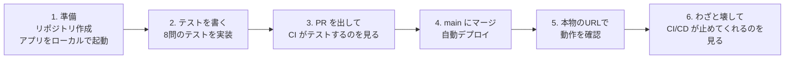

# CI/CD 体験勉強会 — 献立メーカー

「テストを書いて push すると、自動でテスト・ビルドされ、本物のサーバーに反映される」
この流れ(**CI/CD**)を、自分たちの手で体験する勉強会の教材です。

題材は、冷蔵庫の食材を入力すると AI(AWS Bedrock の Claude)が作れる料理を5件提案する Web アプリ「献立メーカー」です。
アプリの作り込みは目的ではありません。**アプリを変更したとき、どうやって安全に・自動で届けるか**を学びます。

## このあと、あなたたちがやること(3人1チーム・約2.5時間)



| 時間(目安) | 内容 |
| --- | --- |
| 0:00 - 0:15 | CI/CD の説明、全体像の確認 |
| 0:15 - 0:35 | 準備: リポジトリ作成、アプリの起動、AWS のキー登録 |
| 0:35 - 0:50 | 例題(問1・問2)を読む。最初の CI を動かす |
| 0:50 - 1:40 | 問3〜問10 を3人で分担して解く。PR を出して CI を緑にし、main にマージする |
| 1:40 - 2:05 | 自動デプロイを見守り、本物の URL で確認 |
| 2:05 - 2:25 | 変更が自動で反映される体験 / わざとテストを壊して**赤くなって止まる**体験 |
| 2:25 - 2:40 | 振り返り、後片付け |

## 最初に読むもの

1. **[勉強会の進め方(ステップごとの手順)](docs/workshop-guide.md)** ← まずここ。当日はこの手順書の順に進めます
2. [CI/CD とは? このパイプラインの仕組み](docs/cicd-overview.md) ← 手を動かしながら、わからなくなったら読む
3. [困ったとき(よくあるエラーと対処)](docs/troubleshooting.md)

## 事前に確認しておくこと(各自のPC)

- [ ] **GitHub のアカウント**を持っている(チームで1人以上。リポジトリを作る人)
- [ ] **Git** が使える(`git --version` でバージョンが表示される)
- [ ] **Docker Desktop** がインストールされ、起動している(`docker --version` でバージョンが表示される)
- [ ] テキストエディタ(VS Code など)が使える

Java や Node.js を個別にインストールする必要はありません。実行環境はすべてコンテナの中に入っています。

## 当日に配られるもの(進行役から受け取る)

| もの | 使う場面 |
| --- | --- |
| **チーム名**(例: `workshop-user01`) | デプロイ先を見分けるための名前 |
| **AWS のアクセスキー**(2つの値: `AWS_ACCESS_KEY_ID` と `AWS_SECRET_ACCESS_KEY`) | GitHub の Secrets に登録し、自動デプロイに使う |
| **Bedrock の API キー**(1つの値) | 手元でアプリを動かすときに `backend/.env` に書く |
| **デプロイ先の URL**(`http://...`) | 自動デプロイされたアプリを開く |

> **キーの扱い**: これらはあなたたちのチームだけの秘密情報です。**GitHub のコード・README・Issue・チャットに書かないでください**。
> 勉強会が終わったら、進行役が無効にします。

## 技術スタック

| 分類 | 技術 |
| --- | --- |
| フロントエンド | React + TypeScript(Vite) |
| バックエンド | Java 17 + Spring Boot(Gradle) |
| DB | MySQL 8.0 |
| AI | AWS Bedrock(Claude Haiku 4.5) |
| コンテナ | Docker / Docker Compose |
| CI/CD | GitHub Actions |
| デプロイ先 | AWS(ECR、EC2、SSM) |

## ディレクトリ構成

```
.
├─ .github/workflows/ci-cd.yml   # ★ CI/CD の定義(自動で動く手順書)
├─ backend/                      # Java (Spring Boot)
│   └─ src/test/…/SuggestionServiceTest.java   # ★ あなたたちが書くテスト
├─ frontend/                     # React + TypeScript
├─ docs/                         # 手順書・設計書
└─ docker-compose.yml            # 手元で動かす用の構成
```

## アプリの設計について(読まなくても進められます)

[要件定義](docs/requirements.md) / [基本設計](docs/basic-design.md) / [詳細設計](docs/detailed-design.md) / [ローカル実行手順](docs/operations.md)
