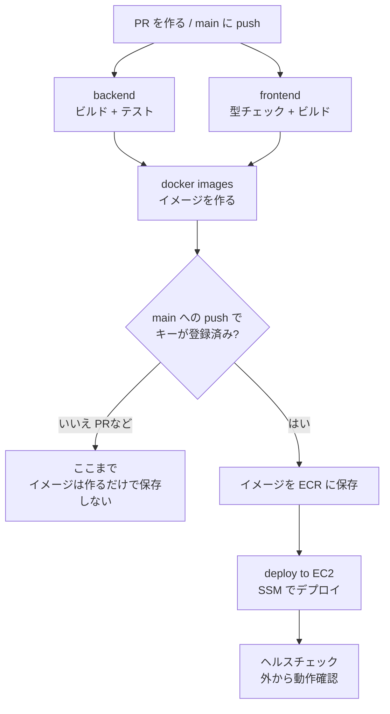
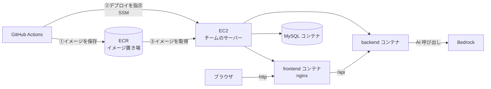

# CI/CD とは? このパイプラインの仕組み

手を動かしながら「いま何が起きているんだろう?」と思ったときに読む資料です。

## CI/CD とは

ソフトウェアを「変更 → 確認 → 届ける」流れを自動化し、**小さな変更を、安全に、何度でも**届けられるようにする考え方と仕組みです。

| 用語 | 意味 | この勉強会では |
| --- | --- | --- |
| **CI**(継続的インテグレーション) | 変更を入れるたびに、**ビルドとテストを自動で実行**する。壊れたら、すぐ気づく | PR や push のたびに動く `backend` / `frontend` / `docker images` のジョブ |
| **CD**(継続的デリバリー / デプロイ) | CI を通ったものを、**サーバーに自動で届ける** | `main` に入ったときに動く `deploy to EC2` のジョブ |

### CI/CD がないと、どうなるか

| 手作業のとき | CI/CD があるとき |
| --- | --- |
| 「自分のPCでは動いた」を信じて出す | まっさらな環境で、毎回自動で確認される |
| テストの実行を忘れる | 忘れようがない(自動) |
| デプロイ手順が人によって違う | 手順がコード(`ci-cd.yml`)に書いてあり、誰がやっても同じ |
| 失敗に、出したあとで気づく | 出す前に止まる |
| デプロイが怖くて、まとめて大きく出す | 小さく何度も出せる |

## このパイプラインの全体像

定義は [`.github/workflows/ci-cd.yml`](../.github/workflows/ci-cd.yml) の1ファイルに書かれています。
**読めるようになるのが、今日のゴールの一つです**。上から順に、読んでみてください。

### 各ジョブの役割

| ジョブ | やること | 失敗するのは、どんなとき? |
| --- | --- | --- |
| **backend** | Java のコードをコンパイルし、**テストを実行**する(`gradle build`) | コンパイルエラー、テストの失敗 |
| **frontend** | TypeScript の型を検査し、画面をビルドする(`npm ci` → `npm run build`) | 型エラー、ビルドエラー |
| **docker images** | アプリを動かす**コンテナイメージ**を作る。main のときは ECR に**保存**する | Dockerfile の誤り、AWS の認証エラー |
| **deploy to EC2** | チームのサーバー(EC2)に「このバージョンに入れ替えて」と指示し、動作を確認する | サーバーが見つからない、入れ替えの失敗、起動後に応答しない |

**`needs:` の線**がポイントです。`docker images` は、`backend` と `frontend` が**両方成功したときだけ**動きます。`deploy` は、`docker images` が成功したときだけ動きます。
つまり、**テストが1つでも落ちると、本番には届きません**。

## AWS 側の構成

| 要素 | 役割 |
| --- | --- |
| **ECR** | コンテナイメージの置き場所(Docker Hub の、AWS 版)。チームごとに専用の置き場がある |
| **EC2** | AWS 上の仮想サーバー。チームごとに1台。中で Docker が動き、3つのコンテナ(frontend、backend、MySQL)が動く |
| **SSM** | AWS 上のサーバーに、リモートから安全にコマンドを実行する仕組み。SSH(鍵を使った接続)を使わずに済む |
| **Bedrock** | AI(Claude)を呼び出すサービス。EC2 は、**サーバーに付けた権限(IAM ロール)**で呼び出す。キーはサーバーに置いていない |

### 同じアプリでも、動き方が少し違う

| | 手元(localhost) | クラウド(EC2) |
| --- | --- | --- |
| フロント | Vite の開発サーバー(`docker-compose.yml`) | ビルド済みの静的ファイルを nginx で配信(`frontend/Dockerfile.prod`) |
| API の呼び方 | ブラウザが直接 `localhost:8080` を呼ぶ | ブラウザは同じドメインの `/api` を呼び、nginx がバックエンドへ中継する |
| AI の認証 | `backend/.env` の Bedrock API キー | EC2 に付けた IAM ロール |

## 言葉の整理

| 言葉 | 意味 |
| --- | --- |
| **ワークフロー** | GitHub Actions の1つの自動実行の手順書(`.github/workflows/*.yml`) |
| **ジョブ** | ワークフローの中の、作業のまとまり。別々のサーバーで動く |
| **ステップ** | ジョブの中の、1つひとつの作業 |
| **ランナー** | ジョブを実際に実行する、GitHub が用意した使い捨てのサーバー(`ubuntu-latest`) |
| **Secrets** | 機密情報を安全に保管し、ワークフローからだけ読める仕組み |
| **アーティファクト** | ジョブが作って残す成果物(テストレポート、イメージなど) |
| **コンテナイメージ** | アプリと、その動作に必要な環境を、まとめて固めたもの。どこで動かしても同じに動く |
| **レジストリ** | コンテナイメージの置き場所(ECR など) |
| **デプロイ** | 作ったものを、実際に動いているサーバーへ入れ替えること |
| **ヘルスチェック** | デプロイ後に、アプリが正しく応答するか、外から確かめること |
| **ロールバック** | 問題が出たとき、前の正しいバージョンに戻すこと |

## もう少し考えてみよう(余裕があれば)

- このパイプラインに、**足りないもの**は何だろう?(例: 本番の前の確認環境、手動の承認、失敗時の自動の巻き戻し)
- デプロイ中、**短い時間アプリが止まる**。止めずに入れ替えるには、どんな工夫がある?
- 失敗したとき、**前のバージョンに戻す**には、どうしたらいい?(ヒント: ECR には、過去のコミットごとのイメージが残っている)
