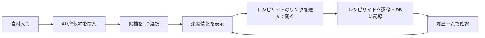
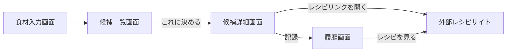

# 献立メーカー 要件定義書

2026-09-17 作成 · @Someone

## プロジェクト概要

献立メーカーは、冷蔵庫にある食材を入力すると、作れる料理の候補を5件提案するWebアプリです。選んだ候補は外部レシピサイトに遷移でき、実際に作った料理は日付付きで記録・再閲覧できます。

- **想定ユーザー**: 献立を考えるのが面倒な人。今回は「CI/CD体験勉強会」の題材として、変更を自動でテスト・デプロイする流れを体験することが目的(アプリ自体の作り込みは目的ではない)
- **コア体験**: 食材入力 → AIによる5候補提案 → 外部レシピサイトへ遷移 → 完成記録 → 履歴からの再訪問

## 技術スタック

| レイヤー | 技術 | 備考・提案 |
| --- | --- | --- |
| フロントエンド | React + TypeScript | Vite構成を推奨。UIライブラリは自由(MUI、Tailwindなど) |
| バックエンド | Java 17 | Spring Boot(Gradle)。DTO は Java の record を使用 |
| DB | MySQL | ローカルは Docker Compose で起動し、環境差をなくす |
| AI連携 | AWS Bedrock(Claude) | バックエンド経由で呼び出す。フロントにAWS認証情報を持たせない |
| レシピ遷移先 | クックパッド / クラシル / 楽天レシピ | 公式APIがないため、検索URL方式を採用。1サイトに依存しないよう3サイト分を提示(詳細は「不足要件」参照) |
| 実行環境 | 手元: Docker Composeでフロント・バックエンド・MySQLを一括起動(詳細は基本設計書を参照)。クラウド: GitHub Actions から AWS(ECR + EC2)へ自動デプロイ(詳細は [CI/CD の解説](cicd-overview.md)) |  |

**認証情報の扱い**: 手元では、Bedrock の API キーをバックエンドの`.env`にのみ置き、`.gitignore`で除外する。クラウド(EC2)では、サーバーに付けた IAM ロールで Bedrock を呼ぶため、キーを置かない。デプロイ用の AWS キーは GitHub の Secrets にのみ登録する。

## 機能要件

1. **食材入力**: 持っている食材をテキストで複数入力できる
2. **候補提案**: 入力食材をもとに、AI(Bedrock)が作れる料理を5件提案する(料理名・簡単な説明・カロリー等の栄養概算値)
3. **候補選択**: 5件の中から作る料理を1つ選ぶ
4. **栄養情報確認**: 選んだ料理のカロリー・脂質・糖質・炭水化物の概算値を表示する
5. **完成**: レシピサイト(クックパッド/クラシル/楽天レシピ)のいずれかのリンクを開くと、レシピサイトへの遷移と、日付・料理名・レシピURLのDB記録を同時に行う
6. **履歴閲覧**: 過去に記録した「いつ・何を作ったか」の一覧を表示する
7. **再訪問**: 履歴の各項目から「レシピを見る」ボタンで、記録時のレシピページに再度遷移できる

## 画面構成

| 画面名 | 概要 | 主な要素 |
| --- | --- | --- |
| 食材入力画面(トップ) | 食材を入力して提案をリクエストする画面 | 食材入力欄(複数可)、送信ボタン |
| 候補一覧画面 | AIが提案した5件の料理を表示する画面 | 料理名・説明、「これに決める」ボタン(各候補ごと) |
| 候補詳細画面 | 選んだ1件の栄養情報を表示する画面 | カロリー・脂質・糖質・炭水化物のstat表示、レシピサイト(クックパッド/クラシル/楽天レシピ)へのリンク一覧 |
| 履歴画面 | 過去に作った料理の記録一覧 | 日付・料理名の一覧、「レシピを見る」ボタン(各行) |

## データベース設計

食材やAIの提案結果は保存せず、「実際に完成した料理」だけを1テーブルで記録するシンプルな構成にします。

**cooking_records テーブル**

| カラム名 | 型 | 説明 |
| --- | --- | --- |
| id | BIGINT (PK, AUTO_INCREMENT) | レコードID |
| dish_name | VARCHAR(255) | 料理名 |
| recipe_url | VARCHAR(1024) | 遷移先レシピURL(再訪問用) |
| cooked_on | DATE | 作った日付 |
| created_at | TIMESTAMP | 記録日時(default CURRENT_TIMESTAMP) |

ユーザーごとに履歴を分けるか(user_idカラムを足すか)は「不足要件」で検討します。

## API設計

| メソッド | パス | 説明 | リクエスト例 | レスポンス例 |
| --- | --- | --- | --- | --- |
| POST | /api/suggestions | 食材からAIが5候補を提案 | `{"ingredients": ["卵", "玉ねぎ"]}` | `{"candidates": [{"name": "オムライス", "description": "...", "calories": 450, "fat": 15, "sugar": 40, "carbs": 55, "recipeLinks": [{"site": "cookpad", "label": "クックパッドで探す", "url": "..."}, ...]}]}` (5件、recipeLinksは3サイト分) |
| POST | /api/records | 完成記録を作成 | `{"dishName": "オムライス", "recipeUrl": "...", "cookedOn": "2026-09-17"}` | `{"id": 1}` |
| GET | /api/records | 記録一覧を取得 | なし | `[{"id": 1, "dishName": "オムライス", "recipeUrl": "...", "cookedOn": "2026-09-17"}]` |

`/api/suggestions`はBedrockにJSON形式での回答を指示するプロンプト設計が肝になります(構造化出力)。

## 不足していた要件・決めるべきこと

1. **レシピサイトへの遷移方法**: Cookpad/クラシル/楽天レシピに公式APIはなく、特定レシピへの直接リンクは技術的に作れません。「料理名でサイト内検索した結果ページ」へのリンクをバックエンドで組み立てる方式を採用し、1サイトの検索精度に依存しないよう3サイト分のリンクを候補ごとに用意します(例: `https://cookpad.com/jp/search/オムライス`)。
2. **AIの提案ロジック**: Bedrock Claudeに5件をJSON配列で返させるプロンプト設計と、パース失敗時のフォールバックが必要です。
3. **認証・ユーザー識別**: ログイン機能は設けず、全員共有のDBを使う方針に決定しました。デモ用に、履歴画面が空にならないようサンプルの完成記録を数件初期投入しています(`backend/db/init.sql`)。
4. **入力バリデーション**: 食材が空欄の場合や、不正な文字列が入力された場合の挙動を決めます。
5. **ローカル開発環境**: Docker Composeでフロント・バックエンド・MySQLをまとめて起動する方針に決定しました。詳細は基本設計書の「開発・実行環境」を参照してください。
6. **AWS認証情報の配布**: チームごとに権限を絞った IAM ユーザーを発行し、勉強会の後に無効化します(進行役が行う)。
7. **エラーハンドリング**: Bedrock呼び出しがエラー・タイムアウトした場合の画面表示を決めます。
8. **デザインの範囲**: UIライブラリを使うか、時間配分上どこまで作り込むかをチームで最初に決めます。

## 勉強会の進め方

このアプリを題材にした CI/CD 体験勉強会の進め方(チーム体制、時間配分、手順)は、[勉強会の進め方](workshop-guide.md) を参照してください。
