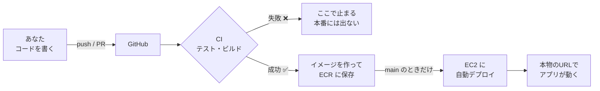

# 勉強会の進め方(ステップごとの手順)

3人1チームで、上から順に進めてください。各ステップの最後に **✅ 確認** があります。確認できたら次へ進みます。
詰まったら [困ったとき](troubleshooting.md) を見て、それでもだめなら進行役に声をかけてください。

## このあとの全体像



- PR(プルリクエスト)では、**CI(テストとビルド)だけ**が動きます。
- `main` ブランチに変更が入ったときだけ、**CD(デプロイ)まで**動きます。

---

## ステップ1: チームのリポジトリを作る(約5分)

チームの代表が1人で行い、残りのメンバーを招待します。

1. ブラウザで [CI-CD_study](https://github.com/kikiki-0604/CI-CD_study) を開く
2. 右上の緑のボタン **「Use this template」→「Create a new repository」** を押す
3. 次のように入力して「Create repository」を押す
   - **Repository name**: 好きな名前(例: `menu-maker-team`)
   - **Visibility**: **Private** を推奨
4. **メンバーを招待する**: 作ったリポジトリの **Settings → Collaborators → Add people** で、残りの2人の GitHub アカウントを追加する(Write 権限)。招待メールまたは GitHub の通知から、承諾する

> 💡 「Use this template」が見つからない場合は、進行役に声をかけてください。

✅ **確認**: チーム3人全員が、作ったリポジトリを開ける。

## ステップ2: 手元に持ってくる(約5分)

**3人全員**が、それぞれのPCで行います。

```bash
git clone https://github.com/<あなたの GitHub アカウント or 代表者のアカウント>/<リポジトリ名>.git
cd <リポジトリ名>
```

✅ **確認**: `ls`(Windows PowerShell なら `dir`)で、`backend`、`frontend`、`docs` が見える。

## ステップ3: アプリを手元で動かす(約10分)

**3人全員**が行います(自分のPCで動かして、アプリを知るためです)。

1. 環境変数のファイルを作る

   ```bash
   cp backend/.env.example backend/.env
   ```
   (Windows PowerShell では `copy backend\.env.example backend\.env`)

2. `backend/.env` をエディタで開き、**配られた Bedrock の API キー**を入れる

   ```
   AWS_BEARER_TOKEN_BEDROCK=ここに配られたキーを貼る
   AWS_REGION=ap-northeast-1
   BEDROCK_MODEL_ID=jp.anthropic.claude-haiku-4-5-20251001-v1:0
   ```

   > ⚠️ `backend/.env` は `.gitignore` で除外済みなので、`git add` しても GitHub には上がりません。ただし、**別のファイルにキーを書いて push しないでください**。

3. 起動する

   ```bash
   docker compose up --build
   ```
   初回は数分かかります。ログが流れ続けます(止めるときは `Ctrl + C`)。

4. ブラウザで http://localhost:5173 を開く

✅ **確認**: 食材(例: 卵、玉ねぎ)を入力して送信すると、料理の候補が5件表示される。

> 確認できたら、いったん `Ctrl + C` で止めて構いません。

## ステップ4: AWS のキーをチームのリポジトリに登録する(約5分)

自動デプロイで、あなたたちのチームの GitHub から、AWS へ接続するための設定です。**チームの代表(リポジトリの作成者)が行います。**

1. GitHub のチームのリポジトリで **Settings → Secrets and variables → Actions** を開く
2. **「New repository secret」** を押し、次の2つを登録する(**名前は一字一句この通り**)

   | Name | Secret(値) |
   | --- | --- |
   | `AWS_ACCESS_KEY_ID` | 配られたアクセスキーID(`AKIA…`で始まる) |
   | `AWS_SECRET_ACCESS_KEY` | 配られたシークレットアクセスキー |

> 🔐 **Secrets とは**: GitHub が暗号化して保管する機密情報です。登録後は、あなたたち自身も値を見られません。
> ワークフローの中からだけ `${{ secrets.AWS_ACCESS_KEY_ID }}` のように読めます。

✅ **確認**: Secrets の一覧に `AWS_ACCESS_KEY_ID` と `AWS_SECRET_ACCESS_KEY` の2つが表示される。

## ステップ5: 例題を読んで、最初のCIを動かす(約15分)

[`backend/src/test/java/com/example/menumaker/service/SuggestionServiceTest.java`](../backend/src/test/java/com/example/menumaker/service/SuggestionServiceTest.java) を開いてください。

- **問1・問2は、解答済みの例題**です。コメントを読んで、書き方をつかんでください。
- **問3〜問10 は、あなたたちが書く問題**です。今は `@Disabled`(実行しない印)と `fail("TODO: ...")` が付いていて、**未完成のまま実行されない状態**です。解くときは、この**2行を消して**実装します。

### 5-1. 手元でテストを動かしてみる

テストの実行は Docker 経由でできます(Java のインストール不要)。**リポジトリのルート**で実行してください。

**Mac / Linux / Git Bash**

```bash
docker run --rm -v "$(pwd)/backend:/app" -v gradle-cache:/home/gradle/.gradle -w /app gradle:8.9-jdk17 gradle test --no-daemon --console=plain
```

**Windows PowerShell**

```powershell
docker run --rm -v "${PWD}/backend:/app" -v gradle-cache:/home/gradle/.gradle -w /app gradle:8.9-jdk17 gradle test --no-daemon --console=plain
```

- 初回は、ライブラリのダウンロードで**数分**かかります(2回目以降は速くなります)。
- 結果は、**問1・問2 が成功、問3〜問10 がスキップ(skipped)**になるはずです。これで正しい状態です(`BUILD SUCCESSFUL` と出ます)。

**1問だけ実行したいとき**(例: 問3)は、最後に `--tests "*SuggestionServiceTest.問3_*"` を付けます。**番号のあとの `_` を忘れないでください**(忘れると `問3` だけでなく `問30` のようなものも対象になります)。

```bash
… gradle test --tests "*SuggestionServiceTest.問3_*" --no-daemon --console=plain
```

### 5-2. 最初の CI を動かす

最初の変更として、手順書のここまでを読んだ印に、README に1行足して push します。

```bash
git checkout -b first-push
echo "" >> README.md
git add README.md
git commit -m "docs: CI/CDの動作確認"
git push -u origin first-push
```

1. GitHub のリポジトリを開くと、「Compare & pull request」と出るので押し、**Pull Request を作る**
2. PR の画面の下に、**CI が動き始めた**のが見える(黄色い丸 → 緑の ✓)
3. 「Details」から、どのジョブが、どの順に動いたかを見る
   (`backend`、`frontend`、`docker images` の3つが動きます。PR では `deploy` は動きません)
4. `backend (build & test)` のログを開き、**テストが10件中、8件スキップされている**のを探す

✅ **確認**: PR の CI が **緑の ✓** になっている。

> 💡 **落とし穴に気づこう**: CI が緑でも、**8問のテストは実行されていません**(スキップ)。
> 「CI が緑 = 品質が守られている」ではありません。**テストを書いて初めて、CI は守ってくれます。**
> このあと、あなたたちがテストを書いていきます。

この PR は、**マージせずに閉じて**(Close pull request)構いません。

## ステップ6: テストを書く(約50分・3人で分担)

問3〜問10 を、**3人で分担**します。おすすめの分担は次の通りです。

| 担当 | 問 | 難易度 |
| --- | --- | --- |
| Aさん | 問3、問4、問5 | 易しい |
| Bさん | 問6、問7 | 中くらい |
| Cさん | 問8、問9、問10 | 考える問題 |

**各自の進め方**

1. `main` を最新にして、自分用のブランチを作る

   ```bash
   git checkout main
   git pull
   git checkout -b test/<あなたの名前>
   ```
2. テストファイルの自分の担当の問を、**ヒントを読みながら実装**する
   (各問のコメントに、準備 → 実行 → 検証の手順、使う道具、つまずきやすい点が書いてあります。**`@Disabled(...)` の行と `fail("TODO…")` の行の、2行を消します**)
3. **1問書くたびに、手元でその問だけ実行**して、緑になるのを確認する(ステップ5-1の「1問だけ実行」)
4. 全部書けたら、コミットして push する

   ```bash
   git add backend/src/test
   git commit -m "test: 問3〜5を実装"
   git push -u origin test/<あなたの名前>
   ```
5. GitHub で **Pull Request を作る**。CI が動くので、**緑の ✓ になるまで**確認する
   (赤くなったら、失敗したテストのログを読んで直して、もう一度 push します。**同じ PR に追加で push すれば、CI が再実行されます**)
6. 緑になったら、チームの誰かが確認して **Merge** する

> 💡 **最初の PR がマージされた瞬間から、`main` への変更として自動デプロイが動き始めます**(ステップ4で AWS のキーを登録済みのため)。
> 先に Actions タブを開いて、様子を見てみましょう。次のステップ7で詳しく見ます。

**気を付けること**

- 同じテストファイルを3人で編集しますが、**別々の問(別のメソッド)**を触る限り、基本的には衝突しません。
- 他の人の PR がマージされたら、**自分のブランチに `main` を取り込む**(`git pull origin main`)と安全です。
- **CI が赤い PR は、マージボタンを押さない**のがルールです。

✅ **確認**: 3人分の PR がマージされ、`main` で、**全10問のテストが実行されて緑**になっている(スキップが0件)。

## ステップ7: 自動デプロイを体験する(約25分)

`main` に変更が入ると、**自動でデプロイ**されます。ここがこの勉強会のハイライトです。
(ステップ6で最初の PR をマージしたときから、すでに動いているはずです。**まだなら、いま、どれかの PR を main にマージしてください**。)

1. GitHub の **Actions** タブを開き、`main` のいちばん上の実行(`CI/CD`)を見つける
   (マージ直後は、動いている最中です)
2. その実行をクリックする
3. 次の順に、ジョブが動くのを眺める

   ```
   backend ─┐
            ├→ docker images (build & push) → deploy to EC2
   frontend ┘
   ```
4. `deploy to EC2` が終わると、実行結果のページ(**Summary**)に、**「デプロイ完了 🚀」と URL**が表示される
5. その URL(または、進行役から配られた URL)を、ブラウザで開く

✅ **確認**: ブラウザで、**あなたたちのチームのアプリが、インターネット上のURLで動いている**。食材を入力して、候補が出ることまで確認する。

> 💡 同じコードが、手元(localhost)でも、クラウド(EC2)でも、同じコンテナで動いています。これがコンテナの強みです。

## ステップ8: 変更が自動で反映されるのを体験する(約10分)

画面の文言を1か所変えて、**手作業なしで本番に反映**されるのを見ます。

1. ブランチを作って、フロントエンドの文言を変える
   例: `frontend/src/` の中から、画面に出ている文言(例: 「献立メーカー」など)を探して、好きな言葉に変える
2. コミット、push、PR 作成、CI が緑になるのを確認、**main にマージ**
3. Actions を見守る → 完了後、デプロイ先の URL を**リロード**して、文言が変わっているのを確認する

✅ **確認**: 手元で何もサーバーを触らずに、画面の文言が本番で変わった。

## ステップ9: わざと壊して、CI/CD が止めてくれるのを見る(約10分)

「壊れた変更が本番に出ない」ことを、実際に確かめます。

1. 新しいブランチを作り、**既存のテストを1つ、わざと失敗させる**
   例: 問1の `isEqualTo(450)` を `isEqualTo(999)` に変える
2. push して PR を作る
3. **CI が赤くなる**のを確認する。そのまま**マージしない**
4. 余裕があれば、Actions の失敗ログを開き、**どの行が、期待値と何が違ったか**を読んでみる
5. 最後に、PR を閉じる(Close)か、元に戻す

> 💡 **学び**: 赤い CI は「ここで止まれ」という合図です。壊れた変更は、本番には出ません。

## ステップ10: 振り返りと後片付け(約15分)

振り返りの観点:

- CI がなかったら、どこで失敗に気づいたか?
- 手動でデプロイするとしたら、何分かかるか?どんなミスが起きそうか?
- 自分の仕事に取り入れるなら、どこから始めるか?

**後片付け**

- 手元のコンテナを止める: `docker compose down`
- `backend/.env` を、念のため削除する(キーが書かれています)
- AWS のキーと Bedrock のキーは、**進行役が勉強会後に無効化**します

お疲れさまでした!
