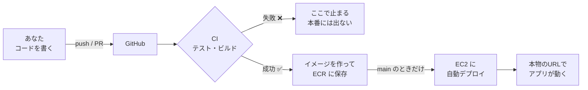

# 勉強会の進め方(ステップごとの手順)

3人1チームで、**上から順に**進めてください。
手順どおりに進めれば、特別な知識がなくても最後までたどり着けるように書いています。

---

## はじめに(最初に5分で読んでください)

### この手順書の見方

| 印 | 意味 |
| --- | --- |
| **✅ 確認** | ここまでできたかのチェック。**できたら次へ**進みます。できていなければ、前の手順を見直すか、質問してください |
| 💡 | 補足の説明。読み飛ばしても進められます |
| ⚠️ | 気を付けること。失敗しやすい点です |
| `グレーの枠のもの` | **ターミナル**に打つコマンド、またはファイル名です。コピーして貼り付けて構いません |

### 困ったときのルール

1. **エラーが出たら、まずメッセージを最後まで読む**(原因が書いてあることが多いです)
2. **5分考えても進まなければ、すぐに声をかける**(遠慮は不要です。勉強会は、詰まった時間がもったいないです)
3. 質問するときは、**エラーメッセージの全文**を見せてください(スクリーンショットで構いません)
4. よくあるエラーは [困ったとき](troubleshooting.md) にまとめてあります

### ターミナルの開き方(コマンドを打つ場所)

コマンドは、**ターミナル**というアプリで打ちます。いちばん簡単なのは、**VS Code の中のターミナル**です。

1. VS Code で、**リポジトリのフォルダを開く**(メニューの「ファイル」→「フォルダーを開く」)
2. メニューの「ターミナル」→「新しいターミナル」を選ぶ
3. 画面の下に、黒い(または白い)入力欄が出ます。ここにコマンドを貼り付けて、**Enter キー**を押します

> 💡 Windows のターミナルは **PowerShell**、Mac は **zsh**(ターミナル.app と同じもの)です。
> コマンドが **Windows と Mac で違う場合は、両方を載せています**。自分のものを使ってください。

### 「リポジトリのルート」とは

**`docker-compose.yml` というファイルがある場所**(プロジェクトの一番上のフォルダ)のことです。
ターミナルで次を打つと、中身の一覧が出ます。`docker-compose.yml`、`backend`、`frontend`、`docs` が見えれば、ルートにいます。

```
ls          (Windows PowerShell でも使えます。`dir` でも同じです)
```

> ⚠️ **コマンドの多くは、ルートで実行する前提**です。VS Code でリポジトリのフォルダを開いてからターミナルを開けば、最初からルートにいます。

### Git と GitHub の用語(これだけ分かれば大丈夫)

| 用語 | 意味 | たとえ |
| --- | --- | --- |
| **リポジトリ** | プロジェクトのファイルと、変更の履歴を入れておく場所 | プロジェクトの倉庫 |
| **GitHub** | リポジトリをインターネット上に置いて、みんなで共有するサービス | 共有の倉庫 |
| **clone(クローン)** | GitHub のリポジトリを、自分のPCにコピーすること | 倉庫から、手元に持ってくる |
| **ブランチ** | 変更を、本流(`main`)とは別に進めるための枝 | 下書き用のコピー |
| **コミット** | 変更を、メッセージ付きで、手元に記録すること | 保存してメモを付ける |
| **push(プッシュ)** | 手元のコミットを、GitHub に送ること | 倉庫に送る |
| **Pull Request(PR)** | 「この変更を `main` に入れてください」という依頼 | 提出して、確認してもらう |
| **マージ(Merge)** | PR の変更を、`main` に取り込むこと | 下書きを、本番の原稿に反映する |
| **`main`** | 本流のブランチ。**ここに入った変更が、本番に反映される** | 本番の原稿 |
| **GitHub Actions** | GitHub 上で、テストやデプロイを自動で実行する仕組み | 自動の検査員・配達員 |
| **CI** | 変更のたびに、**自動でテスト**する仕組み | 自動の検査 |
| **CD(デプロイ)** | 検査を通ったものを、**自動で本番に届ける**仕組み | 自動の配達 |
| **Secrets** | パスワードなどを、安全に保管する GitHub の機能 | 金庫 |

**コミットから `main` に入るまでの流れ**(このあと何度も出てきます):

```
ブランチを作る → ファイルを変更する → コミット(手元に記録) → push(GitHub に送る)
    → PR を作る → CI が自動でテスト → 緑ならマージ → main に入る → 自動デプロイ
```

---

## このあとの全体像



- PR(プルリクエスト)では、**CI(テストとビルド)だけ**が動きます。
- `main` ブランチに変更が入ったときだけ、**CD(デプロイ)まで**動きます。

---

## ステップ1: チームのリポジトリを作る(約5分)

**チームの代表1人**が行います。残りの2人は、代表が作り終えるまで待ちます(ステップ2の準備として、GitHub にログインしておいてください)。

1. ブラウザで [CI-CD_study](https://github.com/kikiki-0604/CI-CD_study) を開く
2. 右上の緑のボタン **「Use this template」→「Create a new repository」** を押す
3. 次のように入力して「Create repository」を押す
   - **Repository name**: 好きな名前(例: `menu-maker-team`)
   - **Visibility**: **Private** を推奨
4. **残りの2人を招待する**
   1. 作ったリポジトリのページで **Settings(設定)→ Collaborators → Add people** を開く
   2. 2人の GitHub のユーザー名を入力して追加する(Write 権限)
   3. **招待された2人**は、**メールか、GitHub の画面上部の通知**から、招待を **承諾(Accept)** する

> 💡 「Use this template」は、元のリポジトリを**コピーして、自分たちのものにする**機能です。履歴は引き継がれず、真っ新な状態で始まります。
> 💡 「Use this template」が見つからない場合は、進行役に声をかけてください。

✅ **確認**: **3人全員**が、チームのリポジトリのページを開ける(ログインした状態で、書き込み権限がある)。

## ステップ2: 手元に持ってくる(約5分)

**3人全員**が、それぞれのPCで行います。

1. チームのリポジトリのページで、緑の **「Code」ボタン** → **HTTPS** のタブ → URL の右のコピーアイコンを押して、**URL をコピー**する
2. ターミナルで、リポジトリを置きたい場所(例: デスクトップ)に移動して、`git clone` する

   ```
   git clone コピーしたURL
   ```
   (`コピーしたURL` の部分を、コピーした URL に置き換えて、Enter を押します。GitHub のログインを求められたら、画面の案内に従います)

3. できたフォルダに入って、VS Code で開く

   ```
   cd リポジトリ名
   code .
   ```
   `code .` が使えない場合は、VS Code を起動して、メニューの「ファイル」→「フォルダーを開く」で、できたフォルダを選びます。

✅ **確認**: VS Code の左側に、`backend`、`frontend`、`docs`、`docker-compose.yml` などが表示されている。

## ステップ3: アプリを手元で動かす(約10分)

**3人全員**が、自分のPCで行います(アプリがどんなものかを知るためです)。

> ⚠️ **AI(Bedrock)には、1分間に呼べる回数の上限があります(チーム全体で約10回)。**
> **3人が同時に「候補を出す」を押さないでください。** 1人ずつ、順番に試します。
> 「候補の取得に失敗しました」と出たら、**30秒ほど待ってから**、もう一度押してください。

### 3-1. 環境変数のファイル(`.env`)を作る

`.env` は、**パスワードやキーなどの、人に見せない設定**を入れるファイルです。見本(`.env.example`)をコピーして作ります。

- **Mac / Linux**:
  ```
  cp backend/.env.example backend/.env
  ```
- **Windows(PowerShell)**:
  ```
  copy backend\.env.example backend\.env
  ```

### 3-2. 配られた Bedrock の API キーを書き込む

1. VS Code で、左のファイル一覧から **`backend/.env`** を開く
2. 一番下の方の `AWS_BEARER_TOKEN_BEDROCK=` の**右側に、配られた Bedrock キーを貼り付ける**
   (`=` の後ろに、**空白やカギ括弧を付けずに**、そのまま貼ります)
3. 保存する(Ctrl + S / Mac は Cmd + S)

```
AWS_BEARER_TOKEN_BEDROCK=ここに配られたキー
AWS_REGION=ap-northeast-1
BEDROCK_MODEL_ID=jp.anthropic.claude-haiku-4-5-20251001-v1:0
```
(`AWS_REGION` と `BEDROCK_MODEL_ID` は、変えません)

> ⚠️ **キーを書いてよいのは `backend/.env` だけです。** `.env.example` や、他のファイル、README には書かないでください(GitHub に上がってしまいます)。
> `.env` は、GitHub に上がらないよう設定済みです(`.gitignore`)。

### 3-3. 起動する

```
docker compose up --build
```

- **初回は数分かかります**(必要なものをダウンロードして、アプリを作るためです)。待ち時間に、ステップ5以降を読んでおくと、時間を有効に使えます。
- ログが流れ続けます。**このターミナルは、起動している間は使えません**(止めるときは `Ctrl + C`)。
- 次のような表示が出たら、起動しています: `Started MenuMakerApplication`(backend)、`VITE ... ready`(frontend)

### 3-4. ブラウザで開く

http://localhost:5173 を開きます。

✅ **確認**: 食材(例: 卵、玉ねぎ)を入れて送信すると、**料理の候補が5件**表示される(数秒かかります)。

確認できたら、起動したターミナルで **`Ctrl + C`** を押して止めます。

> 💡 うまくいかないときは [困ったとき](troubleshooting.md) の「手元のPC」の表を見てください。

## ステップ4: AWS のキーをチームのリポジトリに登録する(約5分)

自動デプロイで、チームの GitHub から AWS に接続するための設定です。**チームの代表(リポジトリを作った人)**が行います。

1. GitHub の、チームのリポジトリのページで、**Settings(設定)→ Secrets and variables → Actions** を開く
2. **「New repository secret」** を押し、次の2つを**1つずつ**登録する(**名前は一字一句この通り**)

   | Name(名前) | Secret(値) |
   | --- | --- |
   | `AWS_ACCESS_KEY_ID` | 配られた**アクセスキー ID**(`AKIA` で始まる20文字) |
   | `AWS_SECRET_ACCESS_KEY` | 配られた**シークレットアクセスキー**(40文字の長い文字列) |

3. 貼り付けたら **「Add secret」** を押す

> ⚠️ **よくあるミス**: 名前の打ち間違い(大文字小文字を含む)、値の**前後に空白や改行**が入る、**ID とシークレットを逆に入れる**。
> 間違えたら、同じ名前でもう一度登録すれば、**上書きできます**。

> 🔐 **Secrets とは**: GitHub が暗号化して保管する、パスワード用の金庫です。登録した後は、あなたたち自身も値を見られません。
> 自動実行(Actions)の中からだけ、`${{ secrets.AWS_ACCESS_KEY_ID }}` のように読めます。

✅ **確認**: Secrets の一覧に、`AWS_ACCESS_KEY_ID` と `AWS_SECRET_ACCESS_KEY` の**2つの名前**が表示されている(値は見えません)。

## ステップ5: 例題を読んで、最初のCIを動かす(約15分)

### 5-0. テストファイルを開く

VS Code で、次のファイルを開きます(左のファイル一覧から探すか、`Ctrl + P` でファイル名 `SuggestionServiceTest` と入力します)。

`backend/src/test/java/com/example/menumaker/service/SuggestionServiceTest.java`

- **問1・問2は、解答済みの例題**です。コメントを読んで、書き方をつかんでください。
- **問3〜問10 は、あなたたちが書く問題**です。今は `@Disabled`(「このテストは実行しない」という印)と `fail("TODO: ...")` が付いていて、**未完成のまま、実行されない状態**です。
- 問題を解くときは、この **2行を消して**、中身を書きます。

> 💡 **Java に慣れていない人へ**: [テストコードの読み方・書き方(Java 入門メモ)](java-test-primer.md) に、このファイルを読むために必要なことだけをまとめました。**分からない記号や書き方が出てきたら、ここを見てください。**

### 5-1. 手元でテストを動かしてみる

テストの実行は **Docker** で行います(Java のインストールは不要です)。**ルートで**、次のコマンドを実行します。

- **Mac / Linux**:
  ```
  docker run --rm -v "$(pwd)/backend:/app" -v gradle-cache:/home/gradle/.gradle -w /app gradle:8.9-jdk17 gradle test --no-daemon --console=plain
  ```
- **Windows(PowerShell)**:
  ```
  docker run --rm -v "${PWD}/backend:/app" -v gradle-cache:/home/gradle/.gradle -w /app gradle:8.9-jdk17 gradle test --no-daemon --console=plain
  ```

💡 このコマンドは、「Gradle(Java のビルドツール)が入った箱(コンテナ)を一時的に起動して、`backend` フォルダの中で、テストを実行する」という意味です。

- **初回は数分**かかります(ライブラリのダウンロードがあるためです)。2回目からは速くなります。
- 最後に **`BUILD SUCCESSFUL`** と出れば成功です。
- この時点では、**問1・問2 が成功、問3〜問10 は「スキップ」**になります(まだ解いていないので、実行されないのが正しい状態です)。

**1問だけ実行したいとき**は、コマンドの最後に `--tests "*SuggestionServiceTest.問3_*"` を付けます(例は問3)。

- **Mac / Linux**:
  ```
  docker run --rm -v "$(pwd)/backend:/app" -v gradle-cache:/home/gradle/.gradle -w /app gradle:8.9-jdk17 gradle test --tests "*SuggestionServiceTest.問3_*" --no-daemon --console=plain
  ```
- **Windows(PowerShell)**:
  ```
  docker run --rm -v "${PWD}/backend:/app" -v gradle-cache:/home/gradle/.gradle -w /app gradle:8.9-jdk17 gradle test --tests "*SuggestionServiceTest.問3_*" --no-daemon --console=plain
  ```

> ⚠️ **問の番号のあとの `_`(アンダースコア)を忘れないでください。** 忘れると、`問1` を指定したときに `問10` も一緒に実行されます。

テストが失敗したときは、画面に **`FAILED`** と、**どのテストが、何を期待して、何が違ったか**が表示されます。

### 5-2. 最初の CI を動かす

まず、**ブランチを作って、README に1行足して、push** してみます。中身はなんでも構いません。目的は、**CI が動く様子を見ること**です。

1. **ブランチを作る**(「first-push」という名前の、作業用の枝を作って、そこに移る)

   ```
   git checkout -b first-push
   ```
2. **README.md を VS Code で開き、一番下に、自分の名前を1行書いて保存する**(例: `参加者: やまだ`)
3. **コミット**する(変更を、メッセージ付きで、手元に記録する)

   ```
   git add README.md
   git commit -m "docs: 参加者の名前を追加"
   ```
   (`git add` は「どのファイルをコミットに含めるか選ぶ」、`git commit -m` は「メッセージを付けて記録する」です)
4. **push**する(GitHub に送る)

   ```
   git push -u origin first-push
   ```
5. **Pull Request を作る**
   1. GitHub のリポジトリのページを開く(または更新する)
   2. 黄色い帯に出る **「Compare & pull request」** を押す
   3. そのまま下の **「Create pull request」** を押す
6. **CI が動くのを見る**
   - PR のページを下にスクロールすると、**「Checks」(チェック)**の欄が出ます
   - 黄色い丸(実行中)が、しばらくして**緑のチェック ✓**に変わります(約3〜5分)
   - **「Details」**を押すと、詳細が見られます

✅ **確認**: PR のチェックが **緑の ✓** になっている(`backend`、`frontend`、`docker images` の3つが動きます。PR では、`deploy` は動きません)。

> 💡 **落とし穴に気づこう**: CI が緑でも、**8問のテストは実行されていません**(スキップ)。
> `backend` の詳細ログで、テストが「10件中、8件スキップ」になっているのを探してみてください。
> **「CI が緑 = 品質が守られている」ではありません。テストを書いて初めて、CI は守ってくれます。**
> このあと、あなたたちがテストを書いていきます。

この PR は、**マージせずに閉じて**(PR のページ下の「Close pull request」)構いません。

### 💡 GitHub での CI の結果の見方(今後も何度も使います)

| 見たいもの | 開き方 |
| --- | --- |
| PR のチェック結果 | PR のページを下にスクロール →「Checks」の欄。**緑 ✓ = 成功、赤 ✗ = 失敗、黄色い丸 = 実行中** |
| 詳しいログ | 「Details」を押す、または、リポジトリ上部の **「Actions」タブ** → 一覧から実行をクリック |
| どのジョブが失敗したか | 実行のページの**左側**に、ジョブの一覧が出る。**赤い ✗ が付いたジョブ**をクリック |
| 失敗の原因 | ジョブの中で、**赤くなったステップ**をクリックして開く。**ログの下の方**に、エラーの内容が出る |

## ステップ6: テストを書く(約50分・3人で分担)

問3〜問10 を、**3人で分担**します。おすすめの分担は次のとおりです。

| 担当 | 問 | 難易度 |
| --- | --- | --- |
| Aさん | 問3、問4、問5 | 易しい |
| Bさん | 問6、問7 | 中くらい |
| Cさん | 問8、問9、問10 | 考える問題 |

**各自の進め方**(自分のPCで、並行して進めます)

1. **`main` を最新にして、自分用のブランチを作る**

   ```
   git checkout main
   git pull
   git checkout -b test/yamada
   ```
   - `git checkout main` は「`main` に移る」、`git pull` は「GitHub の最新を取り込む」、`git checkout -b test/yamada` は「自分用の枝を作って移る」です。
   - `yamada` の部分は、**自分の名前(英数字)**にしてください。日本語は使わないでください。
2. **テストファイルで、自分の担当の問を探し、ヒントを読みながら実装する**
   1. 問のコメントに、**準備 → 実行 → 検証**の手順と、使う道具、つまずきやすい点が書いてあります。**まず、全部読んでください。**
   2. **`@Disabled(...)` の行と、`fail("TODO…")` の行の、2行を消します。**
   3. ヒントを参考に、中身を書きます。**コメントのコードは、そのまま写して構いません**(ただし、意味を考えながら)。
   4. 保存します。
3. **1問書くたびに、その問だけを手元で実行**して、成功するのを確認する(ステップ5-1の「1問だけ実行」)
4. 全部書けたら、**コミットして push**する

   ```
   git add backend/src/test
   git commit -m "test: 問3〜5を実装"
   git push -u origin test/yamada
   ```
5. GitHub で **Pull Request を作る**(ステップ5-2の手順5と同じです)。CI が動くので、**緑の ✓ になるまで**待つ
   - **赤くなったら**: ログを読んで直し、もう一度 **commit と push** をします。**同じ PR に追加で push すれば、CI が自動で再実行**されます。
6. **緑になったら、チームの誰か**が、PR のページの **「Merge pull request」→「Confirm merge」** を押す

> 💡 **最初の PR がマージされた瞬間から、`main` への変更として、自動デプロイが動き始めます**(ステップ4で AWS のキーを登録してあるためです)。
> **Actions タブ**を開いて、様子を見てみましょう(次のステップ7で詳しく見ます)。

**気を付けること**

- 同じファイルを3人で編集しますが、**別々の問**を触る限り、基本的にはぶつかりません。
- 誰かの PR がマージされたら、**自分の作業に取り込む**と安全です:
  ```
  git pull origin main
  ```
- **ぶつかった(コンフリクトした)ときは**、あわてず、[困ったとき](troubleshooting.md) の「Git / GitHub」の表を見るか、声をかけてください。
- **CI が赤い PR は、マージボタンを押さない**のがルールです。

✅ **確認**: 3人分の PR がマージされ、`main` で、**全10問のテストが実行されて緑**になっている(テスト結果で、スキップが0件)。

## ステップ7: 自動デプロイを体験する(約25分)

`main` に変更が入ると、**自動でデプロイ**されます。ここが、この勉強会のハイライトです。
(ステップ6で最初の PR をマージしたときから、すでに動いているはずです。**まだなら、いま、どれかの PR を `main` にマージしてください**。)

1. GitHub の **「Actions」タブ**を開く
2. 一覧の一番上(`main` の最新の実行。名前は **CI/CD**)をクリックする
3. 次の順で、ジョブが動いていくのを眺める(約8〜12分かかります)

   ```
   backend ─┐
            ├→ docker images (build & push) → deploy to EC2
   frontend ┘
   ```
   - 各ジョブは、**黄色い丸(実行中)→ 緑のチェック ✓(成功)**と変わります。
   - ジョブの名前をクリックすると、**いま何をしているかのログ**が見られます。
4. **`deploy to EC2`** が終わったら、実行結果のページの上の方の **「Summary」(サマリー)**を開く
   - **「デプロイ完了 🚀」と、アプリの URL** が表示されています
5. その URL(または、配られた**デプロイ先 URL**)を、ブラウザで開く

✅ **確認**: **あなたたちのチームのアプリが、インターネット上の URL で動いている**。食材を入力して、候補が出るところまで確認する。

> 💡 同じコードが、手元(`localhost`)でも、クラウド(EC2)でも、同じコンテナで動いています。
> これが、コンテナの強みです。「自分のPCでは動いたのに、本番では動かない」を減らせます。

> ⚠️ **最初のデプロイ直後は、画面が出るまで1〜2分かかることがあります**(データベースの準備のため)。ヘルスチェックが終わるまで、待ってください。

## ステップ8: 変更が自動で反映されるのを体験する(約10分)

画面の文言を1か所変えて、**手作業なしで本番に反映される**のを見ます。

1. 新しいブランチを作る

   ```
   git checkout main
   git pull
   git checkout -b ui/yamada
   ```
2. **`frontend/src/pages/IngredientInputPage.tsx`** を開き、**38行目あたり**の `title="今日ある食材は?"` を探して、好きな言葉に変える(例: `title="何を作ろうかな?"`)
   - 画面の一番上の、大きな見出しが変わります。
3. 保存して、コミット、push、PR 作成、**CI が緑になるのを確認**して、**main にマージ**する(ステップ6と同じ手順です)
4. **Actions** で、デプロイが終わるのを待つ(約8〜12分)
5. デプロイ先の URL を**リロード**(ブラウザの更新ボタン。変わらなければ `Ctrl + Shift + R`)して、見出しが変わっているのを確認する

✅ **確認**: サーバーを一切触らずに、画面の見出しが本番で変わった。

## ステップ9: わざと壊して、CI/CD が止めてくれるのを見る(約10分)

「壊れた変更が、本番に出ない」ことを、実際に確かめます。

1. 新しいブランチを作る

   ```
   git checkout main
   git pull
   git checkout -b break/yamada
   ```
2. **既存のテストを1つ、わざと失敗させる**
   - `SuggestionServiceTest.java` の問1の中の `isEqualTo(450)` を、`isEqualTo(999)` に変える
3. 保存して、コミット、push、PR 作成
4. **CI が赤い ✗ になる**のを確認する。**マージはしません**
5. **Actions** の失敗したジョブを開き、ログを読む
   - **どのテストが失敗したか**
   - **期待した値(999)と、実際の値(450)が、どう違ったか**
6. PR を閉じる(**「Close pull request」**)

> 💡 **学び**: 赤い CI は、**「ここで止まれ」という合図**です。壊れた変更は、`main` に入らず、本番にも届きません。
> もしマージしてしまっても、テストが失敗している間は、**デプロイは動きません**(`needs:` の仕組み)。

## ステップ10: 振り返りと後片付け(約15分)

**振り返りの観点**(チームで話してみましょう)

- CI がなかったら、**どこで**失敗に気づいたか?
- 手動でデプロイするとしたら、**何分かかる**か?どんなミスが起きそうか?
- 自分の仕事に取り入れるなら、**どこから**始めるか?

**後片付け**

1. 手元のコンテナを止める(起動していれば)

   ```
   docker compose down
   ```
2. **`backend/.env` を削除する**(キーが書かれています)
3. AWS のキーと Bedrock のキーは、**進行役が、勉強会のあとに無効化**します

お疲れさまでした!
